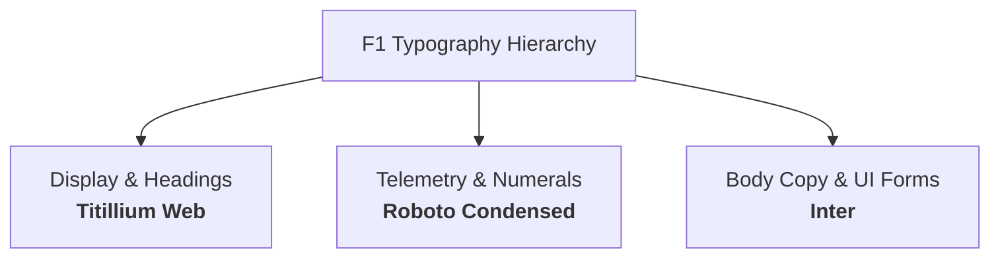

# 🎨 Paddock Telemetry — Design System Specification (`DESIGN.md`)

| Specification | Standard |
| :--- | :--- |
| **System Version** | `2.1.0` (Glassmorphic Pit-Wall Baseline) |
| **Aesthetic Paradigm** | Dark Telemetry Command Console & Formula 1 Broadcasting Graphics |
| **Surface Architecture** | Translucent Glassmorphism (`backdrop-filter: blur(24px)`) |
| **Typography Family** | `Titillium Web` • `Roboto Condensed` • `Inter` |
| **Status** | Active / Platform Standard |

---

## 1. Core Design Philosophy

The Paddock Telemetry visual language is built around three non-negotiable principles:

1. **Authentic Formula 1 Broadcast Aesthetics**:
   The user interface directly mirrors official FIA Formula 1 television broadcasting graphics. Labels, timers, sector deltas, and speed traps use official race terminology.
   > **Prohibited:** Developer-style annotations (`[TEL_01]`, `[MAP_GPS]`, `[USR_AUTH]`) and code-comment slashes (`//`) in visible UI copy.
   > **Mandated:** Clean broadcasting nomenclature (`AI Race Prediction Engine`, `Track Map • Topology & Corner Analysis`, `FIA Formula 1 • World Championship Calendar`).

2. **Translucent Glassmorphism Over Opaque Blocks**:
   Cards, modal overlays, and authentication forms must never obstruct or vertically slice the high-definition Formula 1 photography and circuit wallpapers behind them.
   All primary surfaces employ `backdrop-filter: blur(24px) saturate(140%)` with subtle carbon borders (`rgba(255, 255, 255, 0.12)`) and soft team accent glow.

3. **High-Signal Data Density**:
   Information hierarchy favors immediate legibility under simulated race conditions. Tabular numerals prevent layout jitter during live telemetry stream updates.

---

## 2. Typography Hierarchy

Legacy serif fonts (e.g. `Times New Roman`) are strictly banned across the entire design system. The platform enforces a 3-font hierarchy:



| Token | Font Family | Weight | Letter Spacing | Usage |
| :--- | :--- | :--- | :--- | :--- |
| `--font-display` | `Titillium Web`, sans-serif | `700`, `900` | `-0.01em` to `0.08em` | Primary titles, hero headings, brand badges, modal headers |
| `--font-telemetry` | `Roboto Condensed`, sans-serif | `600`, `700` | `0.02em` | Speed monitors (km/h), sector times, lap deltas, transponder clocks |
| `--font-sans` | `Inter`, system-ui, sans-serif | `400`, `500`, `600` | Normal | Paragraph text, user inputs, options descriptions, tooltips |
| `--font-mono` | `Roboto Condensed`, monospace | `600`, `700` | `0.05em` | Status chips (`tabular-nums`), driver codes (`VER`, `HAM`, `NOR`) |

---

## 3. Color Tokens & Surface Palette

### 3.1 Base Surfaces
```css
:root {
  /* High-Contrast Asphalt & Carbon */
  --asphalt: #05070A;        /* Viewport root background */
  --carbon: #0C1017;         /* Machined card base */
  --carbon-2: #141923;       /* Input & secondary card background */
  --line: #2E3746;           /* Subtle structural separator */
  --paper: #FFFFFF;          /* Pure white high-contrast text */
  --dim: #94A3B8;            /* Subtitle & muted metadata text */
}
```

### 3.2 Status & Flag Colors
- **Green Flag / Uplink Active**: `#00FF9C` (Neon Emerald)
- **Primary Telemetry / Speed Trap**: `#00F0FF` (Cyan Glow)
- **FIA Alert / Safety Car**: `#FFB800` (Amber Caution)
- **Fastest Sector / Benchmark**: `#C840FF` (Purple S3)
- **Track Limit / High Braking / Red Flag**: `#FF1801` (Formula 1 Red)

### 3.3 Pirelli Compound Color Standards
| Compound | Token | Hex | Badge Preview | Application |
| :--- | :--- | :--- | :--- | :--- |
| **Hard (C1–C3)** | `--tyre-hard` | `#FFFFFF` | ⚪ White | Minimum degradation, long stint durability |
| **Medium (C2–C4)** | `--tyre-medium` | `#FFD800` | 🟡 Yellow | Balanced race strategy compound |
| **Soft (C3–C5)** | `--tyre-soft` | `#FF1801` | 🔴 Red | Maximum apex grip, high thermal drop-off |
| **Intermediate** | `--tyre-inter` | `#3ECF8E` | 🟢 Green | Damp asphalt, clearing standing water |
| **Full Wet** | `--tyre-wet` | `#0070F3` | 🔵 Blue | Heavy standing water, monsoon conditions |

---

## 4. Component Design Patterns

### 4.1 Stitch Machined Card (`.stitch-card-machined`)
```html
<div class="stitch-card-machined rounded-2xl p-6 shadow-2xl relative">
  <!-- HUD Header Strip -->
  <div class="flex items-center justify-between border-b border-white/10 pb-2.5 mb-4 text-[10px] font-mono tracking-wider text-slate-400">
    <div className="flex items-center gap-2">
      <span className="stitch-live-dot" />
      <span className="text-cyan-400 font-bold uppercase tracking-wider">SECTION CATEGORY</span>
      <span className="text-slate-500">•</span>
      <span className="text-white font-semibold">Descriptive Broadcast Title</span>
    </div>
    <span className="stitch-data-chip text-[9px] text-[#00FF9C] border-[#00FF9C]/30 font-bold">
      STATUS CHIP
    </span>
  </div>
  ...
</div>
```

### 4.2 Translucent Glassmorphic Authentication Portal (`AuthGate.tsx`)
```css
.centered-login-card {
    position: relative;
    z-index: 10;
    max-width: 460px;
    width: 100%;
    padding: 34px 32px;
    background: rgba(9, 14, 22, 0.65);
    border: 1px solid rgba(255, 255, 255, 0.12);
    border-radius: 24px;
    box-shadow: 0 30px 80px rgba(0, 0, 0, 0.85), 0 0 35px rgba(0, 240, 255, 0.12);
    backdrop-filter: blur(24px) saturate(140%);
    -webkit-backdrop-filter: blur(24px) saturate(140%);
}
```

### 4.3 Action Buttons & Inputs
- **Primary F1 Action**: `linear-gradient(135deg, #00F0FF 0%, #0088FF 100%)`, `border-radius: 12px`, high-contrast black text `#05070A`, cyan drop-shadow.
- **Glass Inputs**: `background: rgba(10, 16, 26, 0.7)`, `border: 1px solid rgba(255, 255, 255, 0.12)`, `border-radius: 10px`, glowing focus ring.
- **Quick-Access Pills**: Unobtrusive compact bars (`px-3.5 py-1.5`) replacing bulky vertical debug blocks.

---

## 5. Circuit Canvas, Orientation & Collision Relaxation Standards

- **Canonical Geographic Orientation Fidelity**: Track paths preserve authentic broadcast orientation. Auto-settle is strictly opt-in (`autoSettle: false` by default) so circuits are never arbitrarily tilted 90° sideways.
- **Unified Coordinate Transformation Pipeline**: FastF1 Cartesian telemetry coordinates (Y-up) invert the vertical axis (`invertY: true`) to map correctly to SVG screen space. High-density SVG centerline paths (`TRACKS_REGISTRY`) operate natively in screen space with `invertY: false`.
- **Collision Clearance & Upright Badges**: Corner badges enforce `MIN_LABEL_DISTANCE = 38px` across 5 iterative relaxation passes, preventing badge jitter and overlap in tight chicanes. Finish line and sector split labels (`FINISH`, `S1 SPLIT`, `S2 SPLIT`) remain upright (`rotate(0)`) even when the track heading points leftward or upward.
- **Asphalt Proportions**: Outer asphalt roadbed is calibrated to `20px` with a `15px` inner tarmac bed and a `4–5px` core sector centerline, preserving sharp definition through tight hairpins and chicanes without geometry blobbing.

