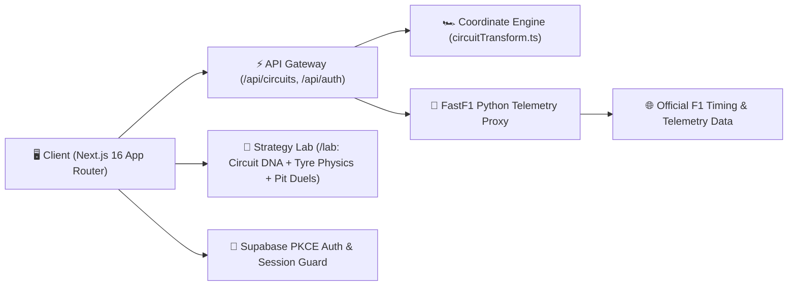

# 🏎️ PADDOCK TELEMETRY — F1 Command Center & Telemetry Reconnaissance

[-black?style=for-the-badge&logo=next.js)](https://nextjs.org/)
[](https://react.dev/)
[](https://www.typescriptlang.org/)
[-3ECF8E?style=for-the-badge&logo=vitest)](./docs/09_TESTING_STRATEGY.md)
[](https://supabase.com/)
[](https://github.com/theOdev/FastF1)
[](https://www.formula1.com/)

**Paddock Telemetry** is a state-of-the-art Formula 1 telemetry, pit-wall reconnaissance, and race replay command center. Built with **Next.js 16 (App Router)**, **TypeScript**, **Supabase PKCE Auth**, and **FastF1 Python telemetry data integration**, Paddock delivers real-time driver tracking, 60fps vector track canvas rendering, teammate head-to-head battle metrics, and comprehensive corner telemetry for **78 F1 circuits**.

---

## 📘 Comprehensive Engineering Documentation Suite

Paddock Telemetry provides an enterprise-grade, modular software engineering documentation suite:

| Specification Document | Focus Area | Description |
| :--- | :--- | :--- |
| **[01_PRD.md](./docs/01_PRD.md)** | Product Requirements | Product vision, target personas, problem statement, and roadmap |
| **[02_SRS.md](./docs/02_SRS.md)** | Software Requirements | Functional & non-functional system requirements and SLAs |
| **[03_USER_STORIES.md](./docs/03_USER_STORIES.md)** | User Stories & BDD | Agile epics, user stories, and Gherkin acceptance criteria |
| **[04_SYSTEM_ARCHITECTURE.md](./docs/04_SYSTEM_ARCHITECTURE.md)** | System Architecture | Next.js 16 + FastF1 + Supabase diagrams, coordinate pipelines |
| **[05_DATABASE_DESIGN.md](./docs/05_DATABASE_DESIGN.md)** | Database Design | PostgreSQL schema, ERD diagrams, triggers, and RLS policies |
| **[06_API_SPECIFICATION.md](./docs/06_API_SPECIFICATION.md)** | API Specification | Complete endpoints reference, caching proxies, and status codes |
| **[07_UI_UX_SPECIFICATION.md](./docs/07_UI_UX_SPECIFICATION.md)** | UI/UX Specification | Dark pit-wall design tokens, tire palettes, 60fps canvas rules |
| **[08_SECURITY.md](./docs/08_SECURITY.md)** | Security Architecture | PKCE auth, hardened CSP without unsafe-eval, rate limiting |
| **[09_TESTING_STRATEGY.md](./docs/09_TESTING_STRATEGY.md)** | QA & Benchmarks | Tracked 1,000-op benchmark suite, concurrency stress tests, build audits |
| **[10_DEPLOYMENT.md](./docs/10_DEPLOYMENT.md)** | Deployment & Ops | Environment matrix, Vercel/Docker deployment, and smoke tests |
| **[STRATEGY_LAB_REDESIGN_PLAN.md](./docs/STRATEGY_LAB_REDESIGN_PLAN.md)** | Strategy Lab Plan | Architecture, correctness audits, and Clean Tabbed Cockpit specs |

---

## ⚡ Key Systems & Core Features

### 🗺️ 1. 78 F1 Circuit Satellite Canvas & Corner Reconnaissance (`/gallery`)
- **Two-Tier Track Registry**:
  - **24 Modern Championship Venues**: Fully verified centerline path vectors (`path`), authentic sector split gates (S1/S2/S3), speed trap coordinates, and calibrated apex telemetry specs (entry/apex/exit speeds in km/h, braking G-forces, typical gear selection, DRS zones).
  - **54 Heritage & Historic Venues**: Track layout outlines, official circuit lengths, corner names, and archival records (e.g. Nordschleife, Brands Hatch, Kyalami, Sepang, Indianapolis).
- **Intelligent Auto-Settle Layout Transform**: Automatically tilts vertically-oriented circuits 90° clockwise so narrow tracks settle comfortably in widescreen viewports.
- **5-Pass Iterative Collision Relaxation**: Dynamically spaces corner badges in tight chicanes with a 38px clearance threshold, preventing badge overlap and eliminating hover jitter.
- **Intelligent Apex Matcher**: Dynamically maps corner selections to verified high-resolution apex photography and fallback team wallpapers.

### ⏱️ 2. 60fps Interactive Race Replay Engine (`/replay`)
- **GPU-Accelerated Canvas Engine**: 60fps telemetry playback engine displaying car positions, gaps, and telemetry graphs.
- **Playback Controls**: Variable rates (1x, 2x, 5x, 10x), scrubber timeline, frame stepping, and lap-by-lap playback.
- **Telemetry Gauges**: Real-time tachometers, speed monitors, DRS status, ERS charge %, and tire compound degradation indicators.

### ⚔️ 3. Teammate Head-to-Head Battle Portal (`/teammates`)
- **Constructor Rivalries**: H2H comparisons across all 10 F1 constructor teams.
- **Telemetry Delta Graphs**: Cumulative championship points progression curves, qualifying pace deltas, and finishing statistics.

### 🔬 4. Clean Tabbed Strategy Lab & Tactical Cockpit (`/lab`)
The Strategy Lab delivers an uncluttered, high-signal Formula 1 tactical command center:
- **Cockpit Tab Switcher (`LabHeader.tsx`)**: High-contrast horizontal tab bar allowing instant switching across four focused tactical workspaces.
- **Unified Session Command Ribbon (`GrandPrixSummaryBar.tsx`)**: Compact 2-row command bar providing Round selection, circuit venue metadata, a liveried Driver 1 vs Driver 2 comparator, and a 4-cell telemetry strip (**Winner • Race Distance • Pole Position • Fastest Lap**).
- **Four Dedicated Tactical Workspaces**:
  1. **Field Pit Stop Strategy (`PitStopReview.tsx`)**: Field pit stop timeline across laps 1 through $N$ with a normalized lap ruler, stationary durations, in/out-lap loss breakdown, and a toggleable alternate undercut simulator.
  2. **Race Pace & Lap Deltas (`WhereWasTimeLost.tsx`)**: Continuous unshifted lap pace progression (`spanGaps: false`), clean pace averages, consistency scores, and head-to-head delta progression with integrated outlier cutoff controls.
  3. **Tyre Stints & Wear Slopes (`TyreStintStory.tsx`)**: Technical Pirelli compound allocation strip (`⚪ Hard`, `🟡 Medium`, `🔴 Soft`), fuel burnoff compensation ($+0.055\text{s/lap}$), and full-grid stint longevity matrix.
  4. **Circuit Demands & Track DNA (`CircuitStrengths.tsx`)**: Chassis trait decomposition (S1 aero, S2 mechanical, S3 traction) with deep links directly into 2D circuit reconnaissance.
- **Explicit Provenance Hierarchy**: Every metric transparently distinguishes **Recorded Timing** (authentic FIA transponders), **Derived Metric** (statistical calculations), and **Simulation / Model** (physics estimates).

### 🔐 5. Enterprise Supabase PKCE Auth & Security
- **Hard Credential Verification**: Multi-layer password authentication with Supabase PKCE.
- **Google OAuth 2.0 PKCE**: Seamless single sign-on with multi-account device chooser (`prompt: 'select_account'`).
- **Mandatory Email Gate**: Enforces verified email status before granting pit-wall telemetry access.

---

## 📐 System Architecture Summary



---

## 🛠️ Environment Setup (`.env.local`)

Create a `.env.local` file in the root directory:

```env
NEXT_PUBLIC_SUPABASE_URL=https://your-supabase-project.supabase.co
NEXT_PUBLIC_SUPABASE_ANON_KEY=your-supabase-anon-key
NEXT_PUBLIC_GOOGLE_CLIENT_ID=your-google-client-id.apps.googleusercontent.com
NEXT_PUBLIC_SITE_URL=http://localhost:3000
JWT_SECRET=your-secure-jwt-secret-key
```

---

## 🚀 Running Locally

```bash
# 1. Install dependencies
npm install

# 2. Start Next.js development server
npm run dev
```

Open **[http://localhost:3000](http://localhost:3000)** in your browser.

---

## 🛩️ Deployment

```bash
# Production build check
npm run build
```

Deploy seamlessly to **[Vercel](https://vercel.com)** by connecting your GitHub repository.
