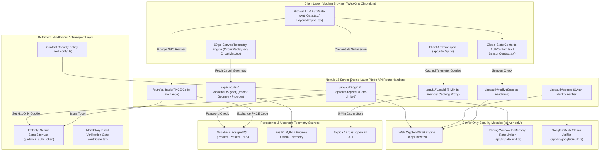
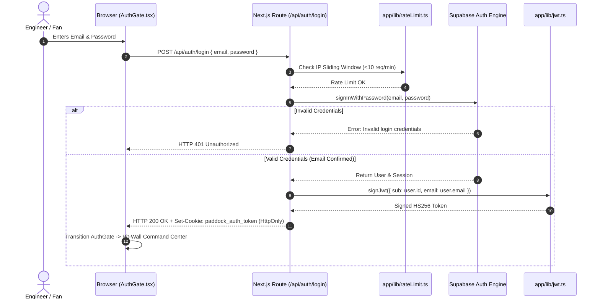

# 🏎️ Paddock Telemetry — System Architecture & Component Design

| Metadata | Details |
| :--- | :--- |
| **Document ID** | `PADDOCK-ARCH-004` |
| **System** | Paddock Telemetry Full-Stack Platform |
| **Version** | `1.0.0` (Production Baseline) |
| **Frameworks** | Next.js 16 (App Router), React 19, TypeScript 5, Supabase |
| **Status** | Approved / Active |

---

## 1. Architectural Philosophy

Paddock Telemetry is architected around three foundational engineering tenets:
1. **Zero-Overhead Client Execution**: Computation-heavy coordinate transformations, rate-limiting, and JWT verification are kept either strictly server-side or hardware-accelerated via HTML5 Canvas GPU pipelines.
2. **Defensive Layering**: No client script has direct access to authentication secrets, sensitive cookies, or un-gated upstream API calls.
3. **Telemetry Determinism**: 60fps canvas replays utilize synchronized timestamp-interpolated coordinate streams rather than erratic real-time polling ticks.

---

## 2. Global System Architecture Diagram



---

## 3. Subsystem Architectural Breakdowns

### 3.1 Authentication & Session Subsystem



### 3.2 60fps Vector Replay Engine (`CircuitReplay.tsx`)

The replay engine is designed to eliminate frame jitter and garbage collection pauses:
1. **Mathematical Coordinate Transform (`circuitTransform.ts`)**:
   - Circuits are stored as normalized GPS coordinates $(X, Y)$.
   - The engine computes bounding boxes, applies an aspect-ratio-preserving projection, and scales coordinates to fit the canvas viewport dimensions:
   $$\text{ScreenX} = (X - X_{\min}) \times \text{Scale} + \text{OffsetX}$$
   $$\text{ScreenY} = (Y - Y_{\min}) \times \text{Scale} + \text{OffsetY}$$
2. **Double-Buffering & Frame Stepping**:
   - `requestAnimationFrame` maintains a timestamp accumulator.
   - For any playback multiplier ($1\times, 2\times, 5\times, 10\times$), the engine performs linear interpolation between telemetry keyframes to position car marker dots smoothly without stutter.
3. **Hardware Acceleration**:
   - The canvas element utilizes `will-change: transform` and 2D canvas context optimizations (`imageSmoothingEnabled = true`).

### 3.3 2D Circuit Telemetry Map Pipeline (`CircuitMap.tsx` & `circuitTransform.ts`)

The circuit map vector pipeline handles high-precision rendering of 78 world championship layouts:
1. **Auto-Settle Aspect Ratio Projection**:
   - Upright vertical layouts (`rangeY > rangeX * 1.15`, e.g., Indianapolis, Monza) are automatically tilted 90° clockwise in `computeTransformBounds()` so tracks settle horizontally and fill standard widescreen viewports with zero clipping.
2. **5-Pass Iterative Collision Relaxation**:
   - In tight chicanes where multiple corners occur within short distances (e.g. Monza T1–2, T4–5, T8–9–10), `transformCorners()` executes a 5-pass iterative relaxation loop enforcing a minimum separation of `MIN_LABEL_DISTANCE = 38px`. Symmetrical displacement ensures leader lines and badges remain clean, balanced, and visually separated.
3. **Jitter-Free SVG Hit Testing & Coordinate Anchoring**:
   - Badges use direct SVG translation `translate(lx, ly)` with `pointerEvents: 'all'`. Dynamic bounding-box recalculation (`transformBox: fill-box`) is intentionally excluded to prevent browser origin shifting on hover.
   - Hover micro-interactions use **color-only CSS transitions** (`transition-colors duration-150`). Geometry properties (`strokeWidth`, `r`) remain fixed during hover, eliminating high-frequency hover oscillation loops.
   - Hit targets use non-overlapping painted targets (`fill="#FFFFFF" fillOpacity="0.001"`) sized at 32×26px for badges and 12px radius for apex anchors.
4. **Gesture Disambiguation & Click Bleed-Through Guards**:
   - Canvas panning enforces a 12px movement threshold (`Math.hypot(dx, dy) < 12`), isolating normal mouse clicks and finger taps from accidental canvas dragging.
   - All interactive nodes feature `data-corner="true"`, allowing canvas drag handlers to immediately yield.
   - Modal backdrop dismissals implement an opening time guard (`modalOpenedAtRef`, 250ms threshold) to prevent the trigger click from bleeding through and immediately closing the modal.

### 3.4 F1 Strategy Lab & Empirical Telemetry Subsystem (`/lab` & `app/lab/components/`)

The Strategy Lab provides an advanced engineering reconnaissance suite built strictly upon 100% empirical timing telemetry and authentic tire degradation physics:
1. **Circuit DNA & Sector Domination Matrix (`CircuitDNASectorMatrix.tsx`)**:
   - **Empirical Sector Decomposition**: Deconstructs authentic FIA timing sessions into **Sector 1** (high-speed aero downforce & corner load), **Sector 2** (mechanical traction, low-speed braking & chicane direction change), and **Sector 3** (power unit / DRS efficiency and speed traps).
   - **Theoretical Ultimate Lap**: Dynamically synthesizes the fastest individual micro-sectors (purple sectors) achieved by any driver during the weekend to calculate the theoretical ceiling of the venue:
     $$\text{Lap}_{\text{Ultimate}} = \min(S_1) + \min(S_2) + \min(S_3)$$
   - **Constructor Aero Dominance**: Maps team chassis efficiency profiles comparing high-speed aerodynamic efficiency against low-speed mechanical compliance.
2. **Head-to-Head Tactical Strategy Duel Engine (`TacticalStrategyDuel.tsx`)**:
   - **Race Pace Delta & Undercut Simulator**: Merges authentic long-run race pace deltas with an interactive 1-stop vs. 2-stop pit strategy engine.
   - **Live Gap Evolution**: Computes cumulative track gap progressions over all race laps including in-lap and out-lap time losses.
   - **Safety Car / VSC Scenario Injections**: Injects tactical pit window compression: Safety Car ($14\text{s}$ stationary/transit loss) and Virtual Safety Car ($11\text{s}$ loss) vs standard green flag pit loss ($22\text{s}$ loss).
3. **Pirelli C1–C5 Tyre Degradation & Stint Whisperer Lab (`TyreDegradationLab.tsx`)**:
   - **Official Circuit Allocations**: Ingests track-specific Pirelli compound nominations (`CIRCUIT_PIRELLI_ALLOCATIONS`) mapping C1 (hardest) to C5 (softest) across the 24 Championship venues.
   - **3-Phase Non-Linear Thermal Cliff Model**:
     - *Phase 1 (Scrub-in Peak, Laps 1–3)*: Surface adhesion and peak mechanical grip.
     - *Phase 2 (Management Plateau)*: Linear compound degradation ($\Delta\text{s/lap}$) adjusted by driving style.
     - *Phase 3 (Exponential Thermal Cliff)*: Severe thermal degradation once lap count exceeds compound cliff threshold ($L > L_{\text{cliff}}$):
       $$\text{Time Penalty} = (\text{Base Wear} \times L) + 0.085 \times (L - L_{\text{cliff}})^{1.55}$$
   - **Dynamic Crossover Lap Detection**: Evaluates the mathematical intersection where a degrading softer compound is overtaken in instantaneous lap pace by a harder compound.
   - **Fuel-Burnoff Compensation**: Applies a $+0.055\text{s/lap}$ correction to decouple genuine tire degradation from vehicle weight reduction.
   - **Tyre Whisperer Index**: Evaluates driver stint management on a normalized 0–100 efficiency scale.

### 3.5 Official Live Telemetry & SignalR Ingestion Subsystem (`/live` & `scripts/f1-proxy.js`)

The Live Telemetry console adheres strictly to an authentic, zero-mock-data pit-wall pipeline:
1. **Zero Mock Data Architecture**:
   - Strictly prohibits hardcoded initial driver rosters (`INITIAL_DRIVERS`) or artificial noise generators (`generateAnchorLapTimes`).
   - The driver grid initializes cleanly as an empty array (`[]`).
2. **Official FIA Pit-Wall Standby State**:
   - When no session is active on track, the classification table renders an authentic FIA Standby card displaying verified session timetables and T-minus countdowns from `API_BASE/current.json`.
   - Weather displays `— / —` until real environmental sensors transmit.
3. **Dynamic Multi-Channel SignalR Ingestion**:
   - Subscribes to official F1 timing channels: `Heartbeat`, `TimingData`, `TimingStats`, `TimingAppData`, `DriverList`, `WeatherData`, `TrackStatus`, `SessionInfo`, and `RaceControlMessages`.
   - `DriverList` dynamically registers drivers with car numbers, broadcast codes, and constructor IDs.
   - `TimingData` dynamically creates and updates positions, lap times, trap speeds, and micro-sector splits (S1/S2/S3).
   - `TimingAppData` updates tyre stints and compound age.

---

## 4. Codebase Composition & Volume Metrics

The Paddock platform comprises modular TypeScript, React, and server-side components:

| Component Category | File Count | Line Count | Codebase Share |
| :--- | :--- | :--- | :--- |
| 🎨 **Frontend UI & Visual Telemetry** | 41 Files | ~14,100 Lines | **65.6%** |
| ⚙️ **Backend API Routes & Cryptography** | 12 Files | ~4,820 Lines | **22.4%** |
| 🗄️ **Database Schemas & Data Configs** | 6 Files | ~2,580 Lines | **12.0%** |
| 🏁 **Total Active Volume** | **59 Files** | **~21,500 Lines** | **100.0%** |

```text
Component Distribution:
[████████████████████████████████████████████████████████████] 65.6% Frontend UI
[██████████████████████] 22.4% Backend APIs & Security
[████████████] 12.0% Database & Config
```

---

## 5. Security & Isolation Boundaries

1. **`import 'server-only'` Barrier**:
   - The Web Crypto HS256 engine in [`app/lib/jwt.ts`](file:///c:/Users/Lenovo/OneDrive/Desktop/Projects/paddock/app/lib/jwt.ts) explicitly declares `import 'server-only'`. Any attempt to import cryptographic signing utilities inside client components triggers an immediate Next.js compilation error.
2. **HttpOnly Cookie Isolation**:
   - The authentication token (`paddock_auth_token`) is marked `HttpOnly; Secure; SameSite=Lax`. JavaScript running in the browser cannot read or exfiltrate the token via `document.cookie`.
3. **Sliding-Window Memory Store**:
   - Route rate limits are evaluated against an in-memory sliding window queue, discarding expired request timestamps on each hit to prevent memory leaks.
