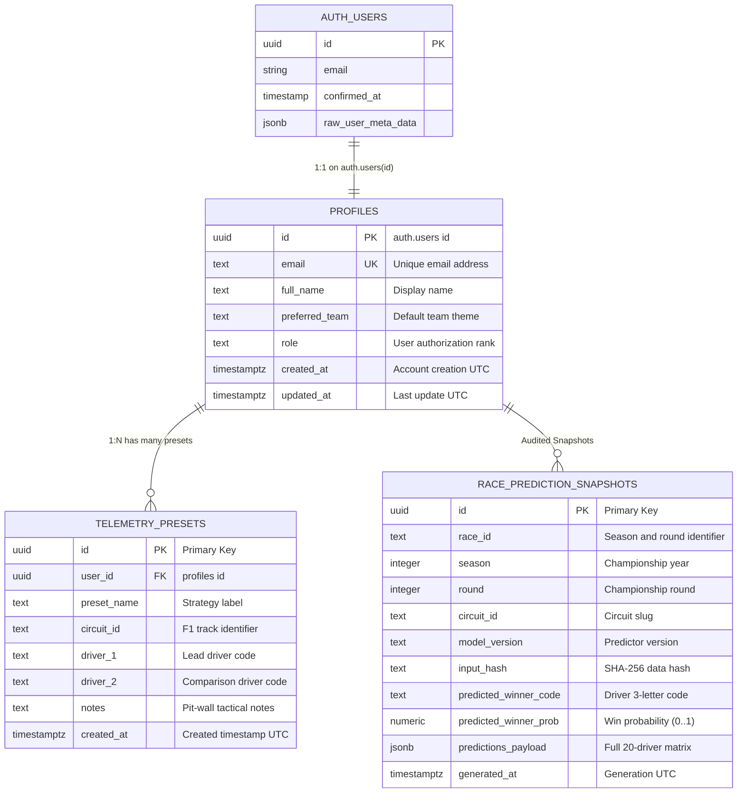

# 🏎️ Paddock Telemetry — Database Design & Schema Specification

| Metadata | Details |
| :--- | :--- |
| **Document ID** | `PADDOCK-DB-005` |
| **Database Engine** | PostgreSQL 15+ (via Supabase) |
| **Version** | `1.0.0` (Production Baseline) |
| **Status** | Approved / Active |
| **Source Schema** | [`supabase/schema.sql`](../supabase/schema.sql) |

---

## 1. Database Overview & Security Model

Paddock Telemetry leverages **Supabase PostgreSQL** for user persistence, authorization metadata, and pit-wall strategy presets. 

The architecture strictly enforces **Row-Level Security (RLS)** across all public tables, guaranteeing that:
1. Public profiles can be read for leaderboard and author attribution, but only modified by their respective authenticated owner.
2. Telemetry strategy presets are isolated per engineer—no user can view, edit, or delete another user's saved strategy sessions.
3. System triggers handle profile creation atomically whenever a new user confirms registration in Supabase Auth.

---

## 2. Entity-Relationship Diagram (ERD)



---

## 3. Data Dictionary & Table Specifications

### 3.1 Table: `public.profiles`
Stores metadata and authorization ranks for telemetry analysts and fans.

| Column | Data Type | Constraints | Default | Description |
| :--- | :--- | :--- | :--- | :--- |
| `id` | `UUID` | `PRIMARY KEY`, `REFERENCES auth.users(id) ON DELETE CASCADE` | — | Unique user ID linked to Supabase Auth. |
| `email` | `TEXT` | `NOT NULL`, `UNIQUE` | — | User's verified email address. |
| `full_name` | `TEXT` | `NULLABLE` | — | User's chosen display name. |
| `preferred_team` | `TEXT` | `NOT NULL` | `'Scuderia Ferrari / Paddock Telemetry'` | Active constructor theme. |
| `role` | `TEXT` | `NOT NULL` | `'Registered Telemetry Analyst'` | System permissions rank. |
| `created_at` | `TIMESTAMPTZ` | `NOT NULL` | `timezone('utc'::text, now())` | Creation timestamp. |
| `updated_at` | `TIMESTAMPTZ` | `NOT NULL` | `timezone('utc'::text, now())` | Last profile update. |

### 3.2 Table: `public.telemetry_presets`
Stores saved head-to-head telemetry setups, circuit configurations, and race strategy notes.

| Column | Data Type | Constraints | Default | Description |
| :--- | :--- | :--- | :--- | :--- |
| `id` | `UUID` | `PRIMARY KEY` | `gen_random_uuid()` | Unique preset identifier. |
| `user_id` | `UUID` | `NOT NULL`, `REFERENCES public.profiles(id) ON DELETE CASCADE` | — | Preset creator. |
| `preset_name` | `TEXT` | `NOT NULL` | — | Title of saved strategy session. |
| `circuit_id` | `TEXT` | `NOT NULL` | — | Target circuit identifier. |
| `driver_1` | `TEXT` | `NOT NULL` | — | Driver 1 identifier. |
| `driver_2` | `TEXT` | `NOT NULL` | — | Driver 2 identifier. |
| `notes` | `TEXT` | `NULLABLE` | — | Engineer notes and observations. |
| `created_at` | `TIMESTAMPTZ` | `NOT NULL` | `timezone('utc'::text, now())` | Timestamp saved. |

### 3.3 Table: `public.race_prediction_snapshots`
Stores immutable post-qualifying Grand Prix winner forecasts with strict version audits and SHA-256 data integrity hashes.

| Column | Data Type | Constraints | Default | Description |
| :--- | :--- | :--- | :--- | :--- |
| `id` | `UUID` | `PRIMARY KEY` | `gen_random_uuid()` | Unique snapshot identifier. |
| `race_id` | `TEXT` | `NOT NULL` | — | Season and round identifier (e.g. `2024_19`). |
| `season` | `INTEGER` | `NOT NULL` | — | Championship season year. |
| `round` | `INTEGER` | `NOT NULL` | — | Championship round index. |
| `circuit_id` | `TEXT` | `NOT NULL` | — | Target circuit venue slug. |
| `circuit_name` | `TEXT` | `NOT NULL` | — | Official circuit name. |
| `prediction_stage` | `TEXT` | `NOT NULL` | `'after_qualifying'` | Session lifecycle phase. |
| `model_version` | `TEXT` | `NOT NULL` | — | Predictor ML model version. |
| `feature_schema_version` | `TEXT` | `NOT NULL` | — | Schema version of feature vector. |
| `input_hash` | `TEXT` | `NOT NULL` | — | SHA-256 hash of input features. |
| `qualifying_status` | `TEXT` | `NOT NULL` | `'completed'` | Verification status of qualifying. |
| `status` | `TEXT` | `NOT NULL` | `'success'` | Forecast calculation status. |
| `predicted_winner_id` | `TEXT` | `NULLABLE` | — | Jolpica driver identifier. |
| `predicted_winner_code` | `TEXT` | `NULLABLE` | — | Official driver 3-letter broadcast code. |
| `predicted_winner_prob` | `NUMERIC(7,4)` | `NULLABLE` | — | Calibrated win probability (0.0000..1.0000). |
| `predictions_payload` | `JSONB` | `NOT NULL` | — | Full 20-driver probability array. |
| `explanatory_factors` | `JSONB` | `NULLABLE` | — | Decomposed performance factor weights. |
| `generated_at` | `TIMESTAMPTZ` | `NOT NULL` | `timezone('utc'::text, now())` | Calculation timestamp. |
| `created_at` | `TIMESTAMPTZ` | `NOT NULL` | `timezone('utc'::text, now())` | Record insertion timestamp. |

---

## 4. Triggers & Stored Procedures

### Automated Profile Provisioning
When a user signs up via Supabase PKCE Auth, the `handle_new_user()` trigger automatically provisions their profile in the `public.profiles` table with default team metadata:

```sql
CREATE OR REPLACE FUNCTION public.handle_new_user() 
RETURNS TRIGGER AS $$
BEGIN
  INSERT INTO public.profiles (id, email, full_name, preferred_team)
  VALUES (
    new.id, 
    new.email, 
    COALESCE(new.raw_user_meta_data->>'full_name', new.email),
    COALESCE(new.raw_user_meta_data->>'preferred_team', 'Scuderia Ferrari / Paddock Telemetry')
  );
  RETURN new;
END;
$$ LANGUAGE plpgsql SECURITY DEFINER SET search_path = public, auth, pg_temp;

-- Trigger execution
DROP TRIGGER IF EXISTS on_auth_user_created ON auth.users;
CREATE TRIGGER on_auth_user_created
  AFTER INSERT ON auth.users
  FOR EACH ROW EXECUTE PROCEDURE public.handle_new_user();
```

---

## 5. Row-Level Security (RLS) Policy Specifications

### `public.profiles` RLS Rules
- **SELECT (Own Profile)**: `CREATE POLICY "Users can view their own profile." ON public.profiles FOR SELECT USING (auth.uid() = id);`
- **SELECT (Public Directory)**: `CREATE POLICY "Authenticated users can view engineer directory." ON public.profiles FOR SELECT TO authenticated USING (true);`
- **INSERT**: `CREATE POLICY "Users can insert their own profile." ON public.profiles FOR INSERT WITH CHECK (auth.uid() = id);`
- **UPDATE**: `CREATE POLICY "Users can update own profile." ON public.profiles FOR UPDATE USING (auth.uid() = id) WITH CHECK (auth.uid() = id AND (role IS NOT DISTINCT FROM (SELECT p.role FROM public.profiles p WHERE p.id = auth.uid())));`
- **ROLE GUARD TRIGGER**: `protect_profile_role()` strictly blocks self-elevation of authorization roles.

### `public.telemetry_presets` RLS Rules
- **SELECT**: `CREATE POLICY "Users can view their own telemetry presets." ON public.telemetry_presets FOR SELECT USING (auth.uid() = user_id);`
- **INSERT**: `CREATE POLICY "Users can insert their own telemetry presets." ON public.telemetry_presets FOR INSERT WITH CHECK (auth.uid() = user_id);`
- **UPDATE**: `CREATE POLICY "Users can update their own telemetry presets." ON public.telemetry_presets FOR UPDATE USING (auth.uid() = user_id) WITH CHECK (auth.uid() = user_id);`
- **DELETE**: `CREATE POLICY "Users can delete their own telemetry presets." ON public.telemetry_presets FOR DELETE USING (auth.uid() = user_id);`

### `public.race_prediction_snapshots` RLS Rules
- **SELECT**: `CREATE POLICY "Public read access for race prediction snapshots." ON public.race_prediction_snapshots FOR SELECT USING (true);`
- **INSERT**: `CREATE POLICY "Service role insert for race prediction snapshots." ON public.race_prediction_snapshots FOR INSERT WITH CHECK (auth.role() = 'service_role' OR auth.role() = 'postgres');`
- **UPDATE (Disallowed)**: `CREATE POLICY "Prevent updates to immutable race prediction snapshots." ON public.race_prediction_snapshots FOR UPDATE USING (false);`
- **DELETE (Disallowed)**: `CREATE POLICY "Prevent deletions of historical race prediction snapshots." ON public.race_prediction_snapshots FOR DELETE USING (false);`

---

## 6. Indexing & Performance Guidelines

To maintain sub-10ms query execution times as user presets and prediction archives scale:
```sql
-- Fast lookup of presets per engineer
CREATE INDEX IF NOT EXISTS idx_telemetry_presets_user_id 
  ON public.telemetry_presets(user_id);

-- Fast circuit-based preset filtering
CREATE INDEX IF NOT EXISTS idx_telemetry_presets_circuit 
  ON public.telemetry_presets(circuit_id);

-- Fast lookup of prediction snapshots by race and season
CREATE INDEX IF NOT EXISTS idx_race_pred_snapshots_race_id 
  ON public.race_prediction_snapshots(race_id);

CREATE INDEX IF NOT EXISTS idx_race_pred_snapshots_season_round 
  ON public.race_prediction_snapshots(season, round);

CREATE INDEX IF NOT EXISTS idx_race_pred_snapshots_lookup 
  ON public.race_prediction_snapshots(race_id, model_version, input_hash);
```

---

## 7. PostgREST 2026 Explicit Table Grants

In compliance with the Supabase PostgREST October 30+ mandate requiring explicit Data API grants on all public tables:
```sql
GRANT SELECT ON public.public_profiles TO authenticated, anon;
GRANT SELECT ON public.profiles TO anon;
GRANT SELECT, INSERT, UPDATE ON public.profiles TO authenticated;
GRANT ALL ON public.profiles TO service_role;

GRANT SELECT, INSERT, UPDATE, DELETE ON public.telemetry_presets TO authenticated;
GRANT ALL ON public.telemetry_presets TO service_role;

GRANT SELECT ON TABLE public.race_prediction_snapshots TO anon;
GRANT SELECT ON TABLE public.race_prediction_snapshots TO authenticated;
GRANT ALL ON TABLE public.race_prediction_snapshots TO service_role;
```
