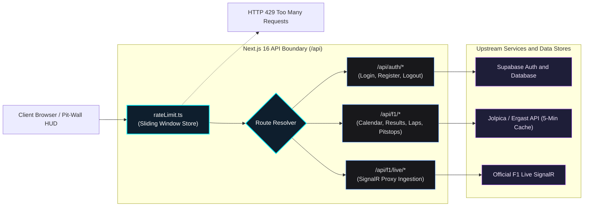

# 🏎️ Paddock Telemetry — API Specification & Route Reference

| Metadata | Details |
| :--- | :--- |
| **Document ID** | `PADDOCK-API-006` |
| **Version** | `1.0.0` (Production Baseline) |
| **Protocol** | HTTPS / JSON / Next.js 16 Route Handlers |
| **Status** | Approved / Active |

---

## 1. Overview & Protocol Standards

All Paddock Telemetry API routes are hosted under the `/api` namespace as Next.js 16 Serverless Route Handlers. 
- **Content-Type**: `application/json; charset=utf-8`
- **Authentication**: Stateful cryptographic sessions via `HttpOnly`, `SameSite=Lax`, `Secure` cookies (`paddock_auth_token`).
- **Rate Limiting**: In-memory sliding window limiter (`app/lib/rateLimit.ts`).




---

## 2. Authentication & Session Endpoints

### 2.1 Register New Account
- **Endpoint**: `POST /api/auth/register`
- **Access**: Public (Rate-limited: 10 req/min/IP)
- **Request Body**:
```json
{
  "email": "engineer@ferrari.it",
  "password": "SecurePassword123!",
  "fullName": "Carlos Sainz",
  "preferredTeam": "Scuderia Ferrari / Paddock Telemetry"
}
```
- **Responses**:
  - `200 OK`: Account created. Confirmation email dispatched.
    ```json
    { "success": true, "message": "Verification email sent. Please confirm your account." }
    ```
  - `400 Bad Request`: Missing fields or password fails complexity rules.
  - `429 Too Many Requests`: IP rate limit exceeded.

---

### 2.2 User Login (Server-Side Verified)
- **Endpoint**: `POST /api/auth/login`
- **Access**: Public (Rate-limited: 10 req/min/IP)
- **Request Body**:
```json
{
  "email": "engineer@ferrari.it",
  "password": "SecurePassword123!"
}
```
- **Response Headers**:
  - `Set-Cookie`: `paddock_auth_token=<HS256_JWT>; Path=/; HttpOnly; Secure; SameSite=Lax; Max-Age=604800`
- **Responses**:
  - `200 OK`:
    ```json
    {
      "success": true,
      "user": {
        "id": "e9c1d09b-6b2e-4b68-8097-123456789abc",
        "email": "engineer@ferrari.it",
        "emailConfirmed": true
      }
    }
    ```
  - `401 Unauthorized`: Invalid credentials or unconfirmed email.
  - `429 Too Many Requests`: Brute-force lockout triggered.

---

### 2.3 Verify Active Session
- **Endpoint**: `GET /api/auth/verify`
- **Access**: Authenticated via Cookie
- **Responses**:
  - `200 OK` (Valid Session):
    ```json
    {
      "authenticated": true,
      "user": {
        "id": "e9c1d09b-6b2e-4b68-8097-123456789abc",
        "email": "engineer@ferrari.it",
        "role": "Registered Telemetry Analyst"
      }
    }
    ```
  - `200 OK` (No Active Session):
    ```json
    { "authenticated": false, "user": null }
    ```

---

### 2.4 Logout Session Revocation
- **Endpoint**: `POST /api/auth/logout`
- **Access**: Authenticated
- **Response Headers**:
  - `Set-Cookie`: `paddock_auth_token=; Path=/; Expires=Thu, 01 Jan 1970 00:00:00 GMT; HttpOnly; Secure`
- **Responses**:
  - `200 OK`:
    ```json
    { "success": true, "message": "Session invalidated successfully." }
    ```

---

### 2.5 Google Identity Verification
- **Endpoint**: `POST /api/auth/google`
- **Access**: Public
- **Request Body**:
```json
{
  "idToken": "eyJhbGciOiJSUzI1NiIsImtpZCI6IjEy..."
}
```
- **Behavior**: Validates signature and audience claims against Google's public JWK set in `app/lib/googleOAuth.ts`, provisions the user if new, and issues the `paddock_auth_token` session cookie.

---

## 3. Circuit Geometry & Track Endpoints

### 3.1 Fetch Circuit Coordinates & Corners
- **Endpoint**: `GET /api/circuits`
- **Access**: Public / Cached
- **Query Parameters**:
  - `category` *(optional)*: `modern` | `historic` | `all` (default: `all`)
- **Responses**:
  - `200 OK`:
    ```json
    {
      "totalCircuits": 78,
      "circuits": [
        {
          "id": "monza",
          "name": "Autodromo Nazionale Monza",
          "country": "Italy",
          "lengthKm": 5.793,
          "cornersCount": 11,
          "coordinates": [[45.6189, 9.2812], [45.6192, 9.2815]],
          "corners": [
            {
              "number": 1,
              "name": "Variante del Rettifilo",
              "entrySpeed": 350,
              "apexSpeed": 75,
              "exitSpeed": 140,
              "gear": 2,
              "lateralG": 2.2
            }
          ]
        }
      ]
    }
    ```

### 3.2 Fetch Calendar Circuits by Year
- **Endpoint**: `GET /api/circuits/[year]`
- **Parameters**: `year` (e.g. `2026`)
- **Responses**:
  - `200 OK`: Array of circuits scheduled in the specified FIA championship season.

### 3.3 Race Winner Prediction Engine
- **Endpoint**: `GET /api/predictions/race/[raceId]`
- **Parameters**: `raceId` in route path (`YYYY_roundNumber`, e.g. `2024_19`, `2026_01`)
- **Query Parameters**:
  - `refresh=true` *(optional)*: Force model re-evaluation and recalculation, bypassing memory and disk caches.
- **Access**: Public / Rate-limited (60 req / 15 min / IP). Supports optional `paddock_auth_token` cookie or `Authorization: Bearer <token>` header.
- **Headers Returned**:
  - `X-Prediction-Stage`: `after_qualifying`
  - `X-Prediction-Status`: `calculated` | `unavailable`
  - `Cache-Control`: `public, s-maxage=300, stale-while-revalidate=86400` (on success) or `no-store` (when unavailable)
- **Responses**:
  - `200 OK` (Calculated Prediction):
    ```json
    {
      "raceId": "2024_19",
      "year": 2024,
      "round": 19,
      "circuitId": "americas",
      "status": "calculated",
      "stage": "after_qualifying",
      "predictedWinner": {
        "driverId": "norris",
        "code": "NOR",
        "driverName": "Lando Norris",
        "teamName": "McLaren",
        "winProbability": 0.4682
      },
      "driverProbabilities": [
        {
          "driverId": "norris",
          "code": "NOR",
          "driverName": "Lando Norris",
          "teamName": "McLaren",
          "gridPosition": 1,
          "winProbability": 0.4682,
          "podiumProbability": 0.8841,
          "top6Probability": 0.9652,
          "pointsProbability": 0.9912,
          "features": {
            "qualifyingPosition": 1,
            "qualifyingDeltaMs": 0,
            "rollingForm": 8.75,
            "constructorAeroIndex": 0.98
          }
        }
      ],
      "explanations": {
        "topFactors": [
          { "factor": "Pole Position Advantage", "weight": 0.38, "description": "Clean-air launch and inside line into Turn 1" }
        ],
        "driverSummaries": {}
      },
      "metadata": {
        "model": "paddock-predictor-catboost-v1.0.0",
        "generatedAt": "2026-10-21T10:14:00.000Z",
        "inputDataHash": "a9f82d1c764e5...",
        "officialResultsVerified": true
      }
    }
    ```
  - `200 OK` (Pre-Qualifying Lockout):
    ```json
    {
      "status": "unavailable",
      "error": "QUALIFYING_NOT_COMPLETED",
      "message": "Saturday Qualifying has not yet completed. Predictions unlock immediately following official grid verification."
    }
    ```
  - `400 Bad Request`: Missing or malformed `raceId` (e.g., `invalid_id`).
  - `429 Too Many Requests`: IP rate limit exceeded (`Retry-After: 60`).
  - `503 Service Unavailable`: Model artifact offline or corrupted.

---

## 4. Telemetry Caching Proxy (`/api/f1/[...path]`)

To protect upstream community servers (Jolpica / Ergast) from being rate-limited during high-traffic race weekends:
- **Endpoint**: `GET /api/f1/[...path]`
- **Upstream Target**: `https://api.jolpica.com/ergast/f1/...`
- **Caching Mechanism**: In-memory response cache with a **5-minute (300,000ms) TTL**.
- **Cache Header**: Returned with `X-Paddock-Cache: HIT` or `X-Paddock-Cache: MISS`.

---

## 5. HTTP Status Code Conventions

| Status Code | Reason | Description |
| :--- | :--- | :--- |
| `200 OK` | Success | Request succeeded and response payload delivered. |
| `400 Bad Request` | Validation Error | Missing parameters, malformed JSON, or invalid syntax. |
| `401 Unauthorized` | Auth Required | Missing, expired, or invalid session token. |
| `403 Forbidden` | Access Denied | Email address not yet verified or account suspended. |
| `405 Method Not Allowed` | Method Mismatch | e.g. GET request sent to a POST-only endpoint. |
| `429 Too Many Requests` | Rate Limited | Sliding window request limit exceeded for client IP. |
| `502 Bad Gateway` | Upstream Outage | Upstream telemetry service (Jolpica / FastF1) unreachable. |
