# 🏎️ Paddock Telemetry — UI/UX Specification & Design System

| Metadata | Details |
| :--- | :--- |
| **Document ID** | `PADDOCK-UI-007` |
| **Version** | `1.0.0` (Production Baseline) |
| **Design Language** | Dark Pit-Wall Telemetry HUD / Glassmorphism |
| **Status** | Approved / Active |

---

## 1. Design Vision & Guiding Principles

The Paddock Telemetry interface is engineered to emulate an **FIA Formula 1 Pit-Wall Engineering Command Console**:
1. **Mission-Critical Legibility**: Dark backgrounds with high-contrast neon accents ensure instant readability of micro-second timing deltas and telemetry curves under intense simulation sessions.
2. **Tactile Micro-Interactions**: Real-time tachometers, speed gauges, and timeline scrubbers feature hardware-accelerated transitions that respond instantly to user input.
3. **Information Density without Clutter**: Modular card grids and collapsible drawers allow users to drill from macro championship standings down to apex G-forces on turn 4 of Suzuka.

---

## 2. Color System & Design Tokens

### 2.1 Base System Tokens
```css
:root {
  /* Surface Darks */
  --bg-paddock-base: #0a0a0f;
  --bg-paddock-surface: #12121a;
  --bg-paddock-elevated: #1a1a24;
  --border-paddock: rgba(255, 255, 255, 0.08);

  /* Brand Accents */
  --accent-f1-red: #e10600;
  --accent-neon-cyan: #00f0ff;
  --accent-telemetry-green: #00e676;
  --accent-warning-yellow: #ffd600;

  /* Typography */
  --font-sans: 'Inter', -apple-system, BlinkMacSystemFont, sans-serif;
  --font-mono: 'JetBrains Mono', 'Fira Code', monospace;
}
```

### 2.2 F1 Tire Compound Palette
| Compound | Token Variable | Hex Code | Visual Swatch | Context |
| :--- | :--- | :--- | :--- | :--- |
| **Soft (C3–C5)** | `--tyre-soft` | `#FF1801` | 🔴 Red | Maximum mechanical grip, fast degradation |
| **Medium (C2–C4)**| `--tyre-medium` | `#FFD800` | 🟡 Yellow | Balanced race strategy compound |
| **Hard (C1–C3)** | `--tyre-hard` | `#FFFFFF` | ⚪ White | Low degradation, long stint durability |
| **Intermediate** | `--tyre-inter` | `#3ECF8E` | 🟢 Green | Damp tracks with standing surface water |
| **Full Wet** | `--tyre-wet` | `#0070F3` | 🔵 Blue | Heavy rain and monsoon conditions |

### 2.3 Constructor Livery Themes
- **Scuderia Ferrari**: Red (`#E8002D`), Gold (`#FFF200`), Carbon Black (`#000000`).
- **Red Bull Racing**: Deep Navy (`#1434CB`), Red (`#ED1B24`), Yellow (`#FCD700`).
- **Mercedes-AMG**: Silver (`#00A19B`), Petro-Cyan (`#00D2BE`), Obsidian (`#0A0A0A`).
- **McLaren**: Papaya Orange (`#FF8000`), Anthracite (`#111111`), Cyan (`#47C7FC`).

---

## 3. Typography & Data Formatting

The typography hierarchy is designed for instant scannability under high-stress race operations:
- **Display & Section Headers**: `Titillium Web` (`font-display`, uppercase, black/bold font weight). Engineered for aerospace and Formula 1 branding aesthetics.
- **Telemetry & Gauge Readings**: `Roboto Condensed` (`font-telemetry`, high-contrast condensed technical numerals). Maximizes data density and horizontal numeral readability.
- **Body & Editorial Copy**: `Inter` (`font-sans`). Neutral, highly legible body text with optimal micro-spacing.
- **Sector Timing & Code**: `JetBrains Mono` (`font-mono` with `font-variant-numeric: tabular-nums`). Prevents layout shifting as lap counters and millisecond timers update.
- **Lap Deltas**:
  - Negative (Faster / Green): `text-emerald-400 font-mono -0.142s`
  - Positive (Slower / Red): `text-rose-400 font-mono +0.389s`

---

## 4. Canvas Telemetry Specifications

### 4.1 60fps Vector Track Canvas (`CircuitReplay.tsx`)
```text
┌────────────────────────────────────────────────────────────────────────┐
│ [LIVE REPLAY HUD]                     Round 08: Monaco GP  [LAP 34/78] │
├────────────────────────────────────────────────────────────────────────┤
│                                                                        │
│                      .-""""-.                                          │
│                    .'  16    '.       (Track Canvas Projection)        │
│                   /   _    _   \                                       │
│                  ;   (_)  (_)   ;     • VER (P1)                       │
│                  |    __    |   • NOR (P2) +1.284s                     │
│                  \   \__/   /         • LEC (P3) +2.411s               │
│                   '.      .'                                           │
│                     `'--'`                                             │
│                                                                        │
├────────────────────────────────────────────────────────────────────────┤
│ [Speedometer: 284 km/h] [RPM: 11,850] [DRS: ACTIVE] [ERS: 84%]        │
├────────────────────────────────────────────────────────────────────────┤
│ [⏮] [◀◀] [ ▶ PLAY ] [▶▶] [⏭]  Speed: [1x] [2x] [5x] [10x]  [00:48:12] │
└────────────────────────────────────────────────────────────────────────┘
```

- **Resolution Scaling**: Canvas dimensions dynamically adapt to `window.devicePixelRatio` to prevent blurriness on Retina/High-DPI displays.
- **Car Node Markers**: 12px circular SVG/Canvas nodes displaying constructor colors and driver three-letter codes (e.g., `HAM`, `VER`, `LEC`).

### 4.2 2D Vector Circuit Map Canvas & Corner Interaction (`CircuitMap.tsx`)
- **Static Unified Header Bar**: Replaces floating semi-transparent cards with an anchored top bar displaying circuit name, country/year, official track length (km), turn count, and viewport controls (`+`, `-`, `↺ Reset`).
- **Anti-Jitter SVG Hover Rules**:
  - Elements positioned via SVG `translate(lx, ly)` must **never** declare CSS `transform-box: fill-box` or `transform-origin: center`. Dynamic recalculation of the bounding box during hover alters the transform matrix in Chromium/WebKit, causing rapid position oscillation (shaking).
  - Hover states exclusively interpolate **color properties** (`transition-colors duration-150`, e.g., `stroke-white`, `fill-red-950/80`). Geometry properties (`strokeWidth`, `r`) remain strictly constant during hover.
- **Chicane Collision Relaxation**: In dense sector complexes (e.g. Monza Turns 1–2, 4–5, 8–9–10), badges maintain an iterative 38px clearance envelope, providing clean leader line separation and zero visual overlap.
- **Right-Sized Collision Hitboxes**: Invisible painted hit targets are constrained to 32×26px for badges and 12px radius for apex anchors (`fill="#FFFFFF" fillOpacity="0.001"`), preventing neighboring corner hitboxes from overlapping.
- **Touch & Gesture Immunity**: Canvas drag listeners (`onMouseDown`, `onTouchStart`) check `target.closest('[data-corner="true"]')` and enforce a 12px drag delta, ensuring corner taps open reconnaissance specs without shifting the canvas.

### 4.3 Strategy Lab & Clean Tabbed Cockpit HUD (`/lab`)
- **Top-Down Cockpit Hierarchy**:

```mermaid
flowchart TD
    PAGE["/lab — Strategy Lab Container"] --> TAB_NAV["LabHeader.tsx — Cockpit Tab Bar"]
    PAGE --> CMD_BAR["GrandPrixSummaryBar.tsx — Unified Command Ribbon"]

    subgraph RibbonDetails["Unified Session Command Bar"]
        R1["Row 1: Season / Round Select • Circuit Venue • Shared Driver 1 vs Driver 2"]
        R2["Row 2: Winner • Race Distance • Pole Position • Fastest Lap"]
        R1 --- R2
    end
    CMD_BAR --> RibbonDetails

    TAB_NAV -->|Active Tab 1| TAB1["PitStopReview.tsx"]
    TAB_NAV -->|Active Tab 2| TAB2["WhereWasTimeLost.tsx"]
    TAB_NAV -->|Active Tab 3| TAB3["TyreStintStory.tsx"]
    TAB_NAV -->|Active Tab 4| TAB4["CircuitStrengths.tsx"]

    subgraph Tab1Features["🛑 Pit Stop Review"]
        T1_A["Hero: Field Pit Stop Timeline (L1..End Lap Ruler)"]
        T1_B["In-Lap / Out-Lap Pace Delta Analysis"]
        T1_C["Stationary Duration Leaderboard"]
        T1_D["Tucked Simulator: '⚔️ SIMULATE ALTERNATE UNDERCUT'"]
        T1_A --> T1_B --> T1_C --> T1_D
    end
    TAB1 --> Tab1Features

    subgraph Tab2Features["⏱️ Race Pace & Gaps"]
        T2_A["Integrated Telemetry Toolbar (Clean Pace / Smooth / Benchmark)"]
        T2_B["Driver 1 vs Driver 2 Telemetry Tiles (Mean, σ, Consistency %)"]
        T2_C["Unshifted Lap-by-Lap Progression & Delta Chart (spanGaps: false)"]
        T2_A --> T2_B --> T2_C
    end
    TAB2 --> Tab2Features

    subgraph Tab3Features["🔴 Tyre Stints"]
        T3_A["Compact 3-Pill Pirelli Strip (Hard / Medium / Soft)"]
        T3_B["Fuel-Compensated Wear Regression (Δs/lap - 0.055s/lap)"]
        T3_C["Grid Stint Longevity Matrix"]
        T3_A --> T3_B --> T3_C
    end
    TAB3 --> Tab3Features

    subgraph Tab4Features["🧬 Circuit Demands"]
        T4_A["Aero vs Mechanical vs Straight-Line DNA Breakdown"]
        T4_B["Deep Link to 2D Circuit Reconnaissance (/gallery?circuit=...)"]
        T4_A --> T4_B
    end
    TAB4 --> Tab4Features

    classDef bar fill:#0e1e2d,stroke:#00f2fe,stroke-width:2px,color:#fff;
    classDef tab fill:#18181b,stroke:#3b82f6,stroke-width:1px,color:#e4e4e7;
    class TAB_NAV,CMD_BAR bar;
    class TAB1,TAB2,TAB3,TAB4 tab;
```




  1. **Cockpit Tab Switcher (`LabHeader.tsx`)**: Anchored at the top with glowing active indicator pills (`bg-gradient-to-r from-cyan-950/80 to-zinc-900 border border-cyan-500/70 text-white`), allowing instant switching between:
     - 🛑 **Pit Stop Review**: Stint chronology, pit loss, and undercut windows.
     - ⏱️ **Race Pace & Gaps**: Discrete unshifted lap-by-lap delta traces.
     - 🔴 **Tyre Stints**: Stint longevity and fuel-compensated wear slopes.
     - 🧬 **Circuit Demands**: Track aero vs mechanical DNA and speed traps.
  2. **Unified Session Command Ribbon (`GrandPrixSummaryBar.tsx`)**:
     - **Session Context**: Compact Round select dropdown, circuit venue badge, and race name.
     - **Comparative Driver Selector**: Team-livery bordered pills (`Driver 1` vs `Driver 2`) acting as single source of truth for all child workspaces.
     - **High-Signal Telemetry Strip**: Ultra-compact 4-cell horizontal bar (`WINNER` P1, `RACE DISTANCE` Laps, `POLE POSITION` Time, `FASTEST LAP` Code/Speed) using 50% less vertical space than legacy cards.
  3. **Decluttered Modular Workspaces**:
     - **`PitStopReview.tsx`**: Field pit stop timeline elevated as the hero visual with a normalized lap ruler (`L1` → `End`). Tactical Undercut Simulator tucked behind a clean `⚔️ SIMULATE ALTERNATE UNDERCUT` button.
     - **`WhereWasTimeLost.tsx`**: Consolidated telemetry control bar (`⚡ CLEAN PACE FOCUS`, `📈 SMOOTH`, `🏁 BENCHMARK`, `CUTOFF`) with compact driver performance tiles and maximum canvas space for continuous pace progression.
     - **`TyreStintStory.tsx`**: 3-pill technical Pirelli allocation strip (`⚪ Hard`, `🟡 Medium`, `🔴 Soft`) replacing text-heavy cards, paired with fuel burnoff sliders and wear degradation models.
     - **`CircuitStrengths.tsx`**: Compact track engineering action bar linking directly to 2D track reconnaissance.
- **Empirical Sector Timing Color Palette**:
  - **Fastest Overall (Purple Benchmark)**: `text-purple-400 bg-purple-950/40 border-purple-500/40` (`#C084FC`).
  - **Personal Best (Green Sector)**: `text-emerald-400 bg-emerald-950/40 border-emerald-500/40` (`#34D399`).
  - **Standard Pace (Yellow Sector)**: `text-amber-300 bg-amber-950/30 border-amber-500/30` (`#FCD34D`).
  - **Speed Traps (Cyan Accent)**: `text-cyan-400 font-mono` (`#22D3EE`).
- **Data Provenance System**:
  - Explicit badge indicators differentiating **Recorded Timing** (authentic FIA transponder data), **Derived Metric** (computed mathematical averages and deltas), and **Simulation / Model** (hypothetical physics-based estimates).

---

## 5. Responsive Grid & Breakpoint Strategy

| Breakpoint | Width Range | Layout Behavior |
| :--- | :--- | :--- |
| **Mobile (`sm`)** | `< 640px` | Single-column stacked cards. Canvas switches to compact pan mode. Bottom sticky playback controller. |
| **Tablet (`md`)** | `640px – 1024px`| 2-column layout. Split view between circuit map and corner telemetry specs. |
| **Desktop (`lg`)**| `1024px – 1536px`| 3-column pit-wall console. Live leaderboards, track canvas, and driver telemetry gauges. |
| **Command Center (`2xl`)**| `> 1536px` | Dual-monitor widescreen optimization with multi-driver telemetry overlay panes. |

---

## 6. Accessibility & Keyboard Control Standards

- **Keyboard Shortcut Mapping**:
  - `Space`: Toggle Replay Play / Pause.
  - `Arrow Left` / `Arrow Right`: Step backward / forward 5 seconds.
  - `Arrow Up` / `Arrow Down`: Increase / decrease playback speed multiplier.
  - `Key M`: Toggle audio/sound telemetry effects.
  - `Key F`: Toggle full-screen command center mode.
- **Screen Reader Support**: All interactive charts and HUD nodes contain descriptive `aria-label` tags (e.g. `aria-label="Turn 4 Variante del Rettifilo apex speed 75 kilometers per hour"`).
