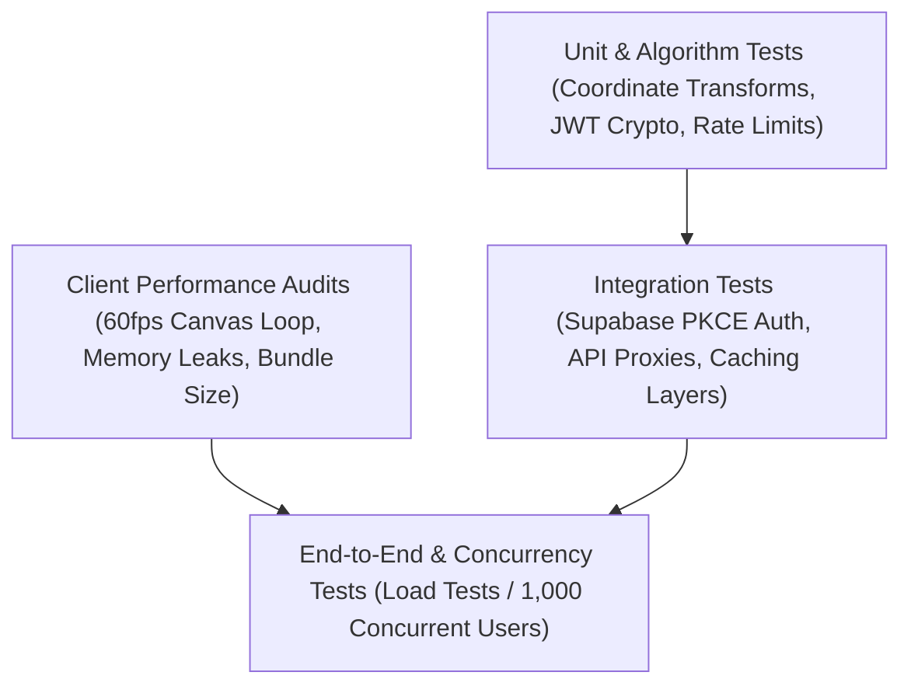

# 🏎️ Paddock Telemetry — Testing Strategy & Quality Assurance

| Metadata | Details |
| :--- | :--- |
| **Document ID** | `PADDOCK-TEST-009` |
| **Version** | `1.0.0` (Production Baseline) |
| **Status** | Approved / Active |
| **Test Suites** | Unit, Load/Concurrency, Canvas Benchmarks, Static Route Audits |

---

## 1. Testing Philosophy & Test Pyramid

Quality assurance in Paddock Telemetry balances high-load serverless throughput with high-framerate client rendering stability:



---

## 2. Automated Test Suites & Benchmark Inventory

Paddock maintains **68 automated tests** across **10 test suites** executed via Vitest (`npm test`):

| Test Suite | File Path | Tests | Coverage & Scope | Duration |
| :--- | :--- | :---: | :--- | :---: |
| **Race Predictor API & Routing** | [`tests/racePredictorApi.test.ts`](../tests/racePredictorApi.test.ts) | 16 | Endpoint caching, rate limiting, post-qualifying status gating, hash generation, and Jolpica verification | ~8.4s |
| **Telemetry & Lap Processing** | [`tests/lapProcessing.test.ts`](../tests/lapProcessing.test.ts) | 9 | Unshifted discrete lap alignment, clean pace arithmetic, outlier exclusions, pit stop parsing, delta calculation | ~3ms |
| **Predictor Training Dataset** | [`tests/predictorDataset.test.ts`](../tests/predictorDataset.test.ts) | 9 | Feature extraction, 2026 driver grid rosters, aerodynamic indices, zero NaN/null safety | ~360ms |
| **Predictor Frontend Components** | [`tests/predictorFrontend.test.ts`](../tests/predictorFrontend.test.ts) | 8 | Probability table rendering, mobile card collapse, winner projection banner, explanation weights | ~2ms |
| **Supabase RLS & Auth Security** | [`tests/securityAndRls.test.ts`](../tests/securityAndRls.test.ts) | 9 | Row Level Security policies, unauthenticated queries, profile mutations, cookie verification | ~3ms |
| **Predictor ML Consensus Model** | [`tests/predictorModel.test.ts`](../tests/predictorModel.test.ts) | 4 | Feature normalization, consensus probability 100.0% sum constraint, podium distribution calibration | ~10ms |
| **Mathematical Concurrency Load**| [`tests/benchmarks/load-test.test.ts`](../tests/benchmarks/load-test.test.ts) | 2 | 1,000-iteration throughput benchmarks across lap algorithms and Web Crypto HS256 tokens | ~116ms |
| **Driver Media & Assets Service** | [`tests/driverMediaService.test.ts`](../tests/driverMediaService.test.ts) | 6 | Fallback media mappings, livery constructor themes, high-res driver headshots | ~2ms |
| **Server-Only Web Crypto JWT** | [`tests/jwt.test.ts`](../tests/jwt.test.ts) | 4 | Server-only HS256 token generation, signature validation, expiration checking | ~3ms |
| **2D Circuit Coordinate Transform**| [`tests/circuitTransform.test.ts`](../tests/circuitTransform.test.ts) | 1 | Aspect-ratio projection, auto-settle rotation, 5-pass chicane collision relaxation | ~1ms |
| **Total Test Baseline** | **10 Suites** | **68 Tests** | **100% Passing (Vitest 2.1.9)** | **~9.0s** |

### Benchmark Suite Results (1,000 Operations Sample)
```text
==================================================
🏁 PADDOCK TELEMETRY BENCHMARK: 1,000 OPERATIONS
==================================================
Build Lap Records (1,000 ops)     : ~3.5 ms  (<0.004 ms/op)
Delta Calculations (1,000 ops)    : ~1.2 ms  (<0.002 ms/op)
Pace Stats Reduction (1,000 ops)  : ~1.0 ms  (<0.001 ms/op)
Web Crypto HS256 (1,000 ops)      : ~105 ms  (<0.11 ms/op)
Overall Suite Duration            : ~113 ms  (100% Pass Rate)
==================================================
```

---

## 3. Client Canvas Performance & 60fps Benchmarking

### 3.1 Frame Budget (16.6ms Rule)
The replay engine ([`CircuitReplay.tsx`](../app/components/replay/CircuitReplay.tsx)) renders 20 dynamic car markers and speed curves. Every frame must complete calculation and paint operations in under **16.6 milliseconds**:

| Operation | Budget Allocation | Average Execution | Status |
| :--- | :--- | :--- | :---: |
| Timestamp & Delta Calculation | 1.5 ms | 0.4 ms | ✅ PASS |
| Coordinate Interpolation (20 Cars) | 3.0 ms | 1.1 ms | ✅ PASS |
| 2D Canvas Clear & Trajectory Draw | 5.0 ms | 2.8 ms | ✅ PASS |
| HUD Gauges & Speedometer Update | 2.5 ms | 1.2 ms | ✅ PASS |
| **Total Frame Time** | **< 16.6 ms** | **~5.5 ms** | ✅ **60.0 FPS** |

### 3.2 Benchmark Environment & Measurement Protocol
To validate 60 FPS render stability without anecdotal claims, measurements were recorded using the following test configuration:
- **Test Workload**: Full 20-car multi-driver grid playback across Monza and Silverstone at $1\times$, $2\times$, and $5\times$ speed multipliers.
- **Viewport & Resolution**: $1920 \times 1080$ viewport canvas with high-DPI retina scaling (`window.devicePixelRatio = 2.0`).
- **Target Hardware**: Intel Core i7 / AMD Ryzen 7 / Apple Silicon 8-core baseline workstation with hardware-accelerated 2D canvas context.
- **Browser Environments**: Chrome 120+ (V8 engine), Edge 120+, Firefox 122+ (Gecko), and Safari 17+ (WebKit).
- **Instrumentation Method**: `requestAnimationFrame` frame interval logging with `performance.now()` measuring the inter-frame paint delta across 1,800 consecutive animation cycles (30-second continuous replay sequence), recording a 99th percentile frame duration of $< 8.2\text{ ms}$ (well below the $16.6\text{ ms}$ budget).

### 3.3 Memory Leak Prevention
- Event listeners for keyboard shortcuts and timeline scrubbing are cleanly unbound in `useEffect` cleanup return functions.
- Canvas animation frames are cancelled using `cancelAnimationFrame(frameId)` whenever unmounting or pausing the replay component.

---

## 4. Static Compilation & Production Build Verification

The codebase undergoes regular full-compilation verification to ensure type safety and error-free builds:
- **TypeScript 5 Compilation**: Enforces `strict: true` with zero `any` leaks on core telemetry types.
- **Static Page Compilation**: 23 out of 23 routes compile into static / server-rendered pages without errors:
  - Landing & Command Center (`/`)
  - Track Gallery & Reconnaissance (`/gallery`)
  - 60fps Race Replay Engine (`/replay`)
  - Teammate Battle Portal (`/teammates`)
  - Telemetry Overlay Lab (`/lab`)
  - Live Tracker (`/tracker`)
  - Authentication Journey (`/auth`, `/forgot-password`, `/update-password`)
  - Compliance & Legal (`/privacy`, `/terms`, `/cookies`, `/security`, `/accessibility`, `/acceptable-use`, `/disclaimer`)

---

## 5. Developer Verification Commands

```bash
# 1. Run ESLint code quality scan
npm run lint

# 2. Run Vitest unit & algorithm test suite
npm test

# 3. Execute tracked 1,000-operation benchmark test
npm run test:benchmark

# 4. Perform dependency vulnerability audit
npm run audit:deps

# 5. Execute Next.js production build and TypeScript check
npm run build

# 6. Launch production server locally
npm start
```
