# Strategy Lab Redesign — Reconnaissance Audit & Implementation Plan

## 1. Reconnaissance Audit

### 1.1 Data Field Provenance & Classification
| Data Field | Source Endpoint | Classification | Validation & Notes |
|---|---|---|---|
| **Season Calendar & Rounds** | `${API_BASE}/${season}.json` | **Recorded Fact** | Official FIA calendar round number, race name, circuit ID, date. |
| **Race Results & Classification** | `${API_BASE}/${season}/${round}/results.json` | **Recorded Fact** | Finishing position, grid, points, status (`Finished`, `+1 Lap`, `Accident`, etc.), completed laps, official fastest lap time & speed. |
| **Driver Lap Records** | `${API_BASE}/${season}/${round}/drivers/${driverId}/laps.json` | **Recorded Fact** | Official transponder lap time recorded per discrete lap number `l.number`. |
| **Pit Stops Chronology** | `${API_BASE}/${season}/${round}/pitstops.json` | **Recorded Fact** | Official pit stop lap number, stop count, time of day, stationary/lane duration. |
| **Circuit Geometry & Demands** | `TRACKS_REGISTRY`, `CIRCUIT_CONDITIONS`, `/data/circuits/2024/*.json` | **Recorded Fact / Calibrated Telemetry** | Verified track length, corner counts, full throttle %, speed trap benchmarks, and corner physics. |
| **Pace Delta ($\Delta t_i$)** | Derived from Driver A & Driver B Laps | **Derived Statistic** | $\Delta t_i = t_{A, i} - t_{B, i}$ strictly matching lap index $i$. |
| **Clean Average Pace & Consistency ($\sigma$)** | Derived from clean laps | **Derived Statistic** | Arithmetic mean and standard deviation after excluding in/out/safety car laps. |
| **Fuel Burnoff Compensation** | Engine model parameter | **Engineering Assumption** | $+0.055\text{s/lap}$ assumed weight loss benefit as fuel burns off. |
| **Pit Loss Assumption** | Track strategy parameter | **Engineering Assumption** | Standard $\sim22.0\text{s}$ stationary/transit loss under green flag, $14.0\text{s}$ under SC, $11.0\text{s}$ under VSC. |
| **Tyre Compound per Stint** | Stint pace & length heuristic | **Inferred / Modeled Estimate** | Ergast API does not provide per-lap compound telemetry. Inferred from stint duration & circuit Pirelli nominations. Must be labeled as estimated. |
| **Sector Splits (Old Code)** | Synthetic multiplication | **UNSUPPORTED / FABRICATED (REMOVED)** | Old `CircuitDNASectorMatrix.tsx` multiplied total lap time by hardcoded ratios + team biases. Removed in favor of verified track geometry and telemetry benchmarks. |

### 1.2 P0 Correctness Flaws in Old Code
1. **Lap Number Shifting Bug (`app/lab/page.tsx:284-299`)**:
   - Array filtering `.filter((t): t is number => t !== null && t > 30)` flattened data into continuous indices $0, 1, 2\dots$.
   - When a lap was missing or excluded (e.g. Lap 15), Lap 16 shifted to index 14 and was labeled "Lap 15" on the X-axis.
   - Comparing Driver A and Driver B across different missing laps resulted in calculating deltas between mismatched race laps.
   - **Fix**: Model each lap as `{ lapNumber: number; time: number | null; isPitStop?: boolean; isOutlier?: boolean }`. Chart X-axis uses official race lap numbers `1 \dots N`. Missing/outlier laps are plotted as `null` with `spanGaps: false`.
2. **Unsupported Telemetry Claims**:
   - Old code claimed "100% REAL TELEMETRY" for synthetic sector splits and unverified compound tags.
   - **Fix**: Transparently distinguish Recorded Facts, Derived Statistics, and Modeled Assumptions. Add prominent data limitation notices.

---

## 2. Component Inventory

| Component | Status | Action & Role |
|---|---|---|
| `app/lab/page.tsx` | Refactor | Core container coordinating shared Season/Round/Driver context, rendering top GP summary and question switcher. |
| `app/lab/types.ts` | Refactor | Define question-driven types, `LapRecord`, `PitStopItem`, `StintRecord`, and GP summary types. |
| `GrandPrixSummaryBar.tsx` | **NEW** | Compact header showing GP details, circuit name, winner, total laps, pole position, and fastest lap. |
| `LabHeader.tsx` | Refactor | Question switcher for the 4 entry points with clear questions, subtitles, and empirical vs modeled badges. |
| `PitStopReview.tsx` | **NEW** | Question 1: "When did drivers pit and what was the observed track impact?" Pit timeline, crew durations, in/out-lap pace impact. |
| `WhereWasTimeLost.tsx` | **NEW** | Question 2: "Where was time lost?" Lap-by-lap pace traces, unshifted lap indices, delta chart, stint averages, consistency index. |
| `TyreStintStory.tsx` | Refactor from `TyreDegradationLab` | Question 3: "How did tyres hold up across each stint?" Stint lengths, fuel-corrected wear slopes, Pirelli nominations, data limitations. |
| `CircuitStrengths.tsx` | Refactor from `CircuitDNASectorMatrix` | Question 4: "Which car characteristics and sector demands define this venue?" Track geometry, demand breakdown, deep links to `/gallery?circuit=...`. |
| `TacticalStrategyDuel.tsx` | Retain as Modal / Sub-Tool | Isolated and clearly designated as a **Hypothetical Simulation Engine** (not historical results). |

---

## 3. Implementation Plan Execution Summary

1. ✅ **Step 1: P0 Correctness & Types Foundation** (`app/lab/types.ts` & `app/lab/utils/lapProcessing.ts`)
   - Strict TypeScript models for `LapRecord` (discrete `lapNumber`), `PitStopItem`, and `StintSummary`.
   - `buildContinuousLapRecords()` guarantees unshifted lap indices $1 \dots N$ with `spanGaps: false`.
2. ✅ **Step 2: Shared Grand Prix Briefing & Controls** (`GrandPrixSummaryBar.tsx`, `LabHeader.tsx`)
   - Shared GP context with Round selector, Circuit info, Driver 1 vs Driver 2 comparator, and 4-metric telemetry strip.
3. ✅ **Step 3: Question 1 — Pit Stop Review** (`PitStopReview.tsx`)
   - Ingests `/pitstops.json`, displays field pit timeline with lap ruler, stationary durations, in/out-lap pace impact, and tucked simulation engine.
4. ✅ **Step 4: Question 2 — Where Was Time Lost?** (`WhereWasTimeLost.tsx`)
   - Continuous unshifted lap pace traces, head-to-head delta chart, outlier filter toolbar (Clean Pace Focus vs Full Scale), and telemetry summary cards.
5. ✅ **Step 5: Question 3 — Tyre Stint Story** (`TyreStintStory.tsx`)
   - Stint segmentation, fuel-compensated degradation slopes ($+0.055\text{s/lap}$ baseline), compact Pirelli allocation strip (C1–C5), and field stint matrix.
6. ✅ **Step 6: Question 4 — Circuit Strengths** (`CircuitStrengths.tsx`)
   - Verified track geometry, aero vs mechanical downforce profile, speed trap benchmarks, and deep links to `/gallery?circuit=${circuitId}`.
7. ✅ **Step 7: Main Workspace Integration** (`app/lab/page.tsx`)
   - Cohesive container orchestrating shared Season, Round, and Driver comparative state.
8. ✅ **Step 8: Verification & Automated Tests**
   - 25 automated unit and benchmark tests passing cleanly across 6 test suites (`npm test`).
   - TypeScript compilation verified with 0 errors (`npx tsc --noEmit`).

---

## 4. Post-Implementation Polish: Clean Tabbed Cockpit

Based on user experience feedback regarding information density and visual clustering, the Strategy Lab underwent a major UX decluttering pass:

```mermaid
graph TD
    subgraph LegacyLayout["Legacy Strategy Lab (Cluttered / Overwhelming)"]
        L_HEADER["4 Bulky Question Cards (Tall Hero Banner)"]
        L_GP["Tall Grand Prix Details Box"]
        L_DUPE1["Driver 1 & 2 Selectors"]
        L_DUPE2["Redundant Child Driver Dropdowns"]
        L_SCROLL["Multi-layer Scroll & Competing Information"]
        L_HEADER --> L_GP --> L_DUPE1 --> L_DUPE2 --> L_SCROLL
    end

    subgraph ModernLayout["Redesigned Clean Tabbed Cockpit (High Signal-to-Noise)"]
        M_TABS["Top-Anchored Horizontal Cockpit Tabs (LabHeader.tsx)<br/>[ 🛑 Pit Stop Review | ⏱️ Race Pace & Gaps | 🔴 Tyre Stints | 🧬 Circuit Demands ]"]
        M_BAR["Unified 2-Row Session Command Ribbon (GrandPrixSummaryBar.tsx)<br/>Row 1: Round Pill • Circuit Badge • Single Shared Driver 1 vs Driver 2 Comparator<br/>Row 2: Compact 4-Cell Telemetry Ribbon (Winner | Distance | Pole | Fastest Lap)"]
        M_VIEW["Single Focused Active Workspace<br/>(Only 1 Analytical Domain Rendered at a Time)"]
        M_HERO["Elevated Hero Visuals<br/>(e.g., L1..End Pit Timeline Ruler / High-Density Telemetry Cards)"]
        M_TABS --> M_BAR --> M_VIEW --> M_HERO
    end

    style LegacyLayout fill:#1a1414,stroke:#f87171,stroke-width:1px,color:#fca5a5
    style ModernLayout fill:#0c1a1a,stroke:#38bdf8,stroke-width:2px,color:#bae6fd
```

1. **Top-Down Visual Hierarchy**:
   - Swapped layout so the **Page Title & Cockpit Tab Switcher** (`LabHeader.tsx`) sits prominently at the top.
   - Positioned the **Session Command Bar** (`GrandPrixSummaryBar.tsx`) directly below the tabs, followed by the focused active workspace.
2. **Unified Session Command Ribbon (`GrandPrixSummaryBar.tsx`)**:
   - Replaced multi-line, tall stat boxes with a sleek 2-row command bar:
     - Row 1: Compact Round select pill, circuit location, and Driver 1 vs Driver 2 comparator with livery accents.
     - Row 2: Slim 4-metric telemetry ribbon (Winner, Race Distance, Pole Position, Fastest Lap).
3. **Driver Selection Centralization**:
   - Removed duplicate, confusing secondary driver dropdowns from child components.
   - Driver 1 and Driver 2 selected in the session bar now serve as the single source of truth across all workspaces.
4. **Hero Visualization Elevation**:
   - In `PitStopReview.tsx`, the **Field Pit Stop Timeline** was moved to the top of the workspace as the hero visual, equipped with a clear lap-number ruler.
   - The hypothetical undercut simulator was tucked neatly behind a single `⚔️ SIMULATE ALTERNATE UNDERCUT` button.
5. **Integrated Telemetry Controls**:
   - In `WhereWasTimeLost.tsx`, the outlier toolbar and clean pace filters were merged into a compact action bar.
   - Driver statistical cards were condensed into high-density telemetry tiles.
6. **Compact Technical Allocations**:
   - In `TyreStintStory.tsx`, bulky paragraph boxes were replaced with a crisp 3-pill Pirelli allocation strip (`⚪ Hard`, `🟡 Medium`, `🔴 Soft`).

